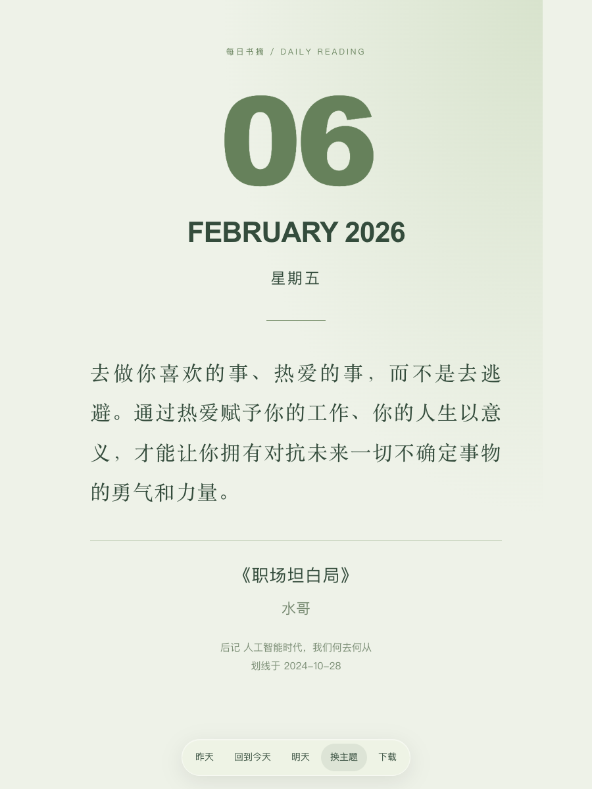
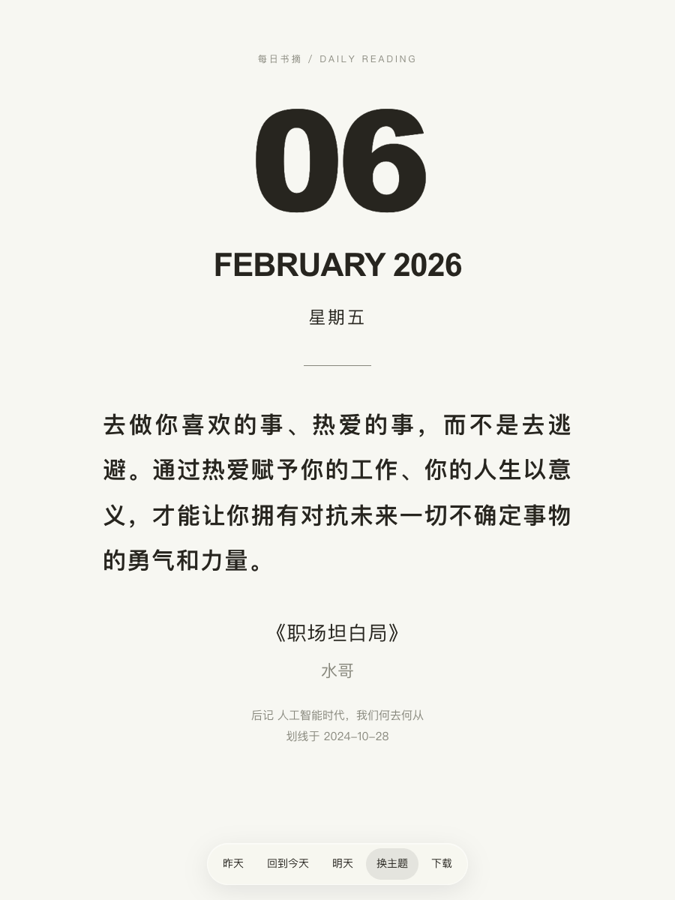
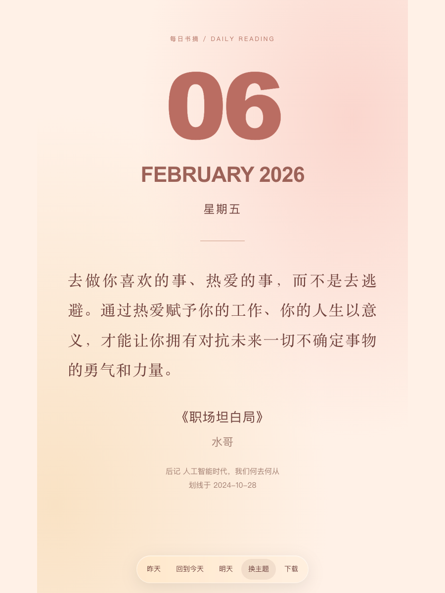
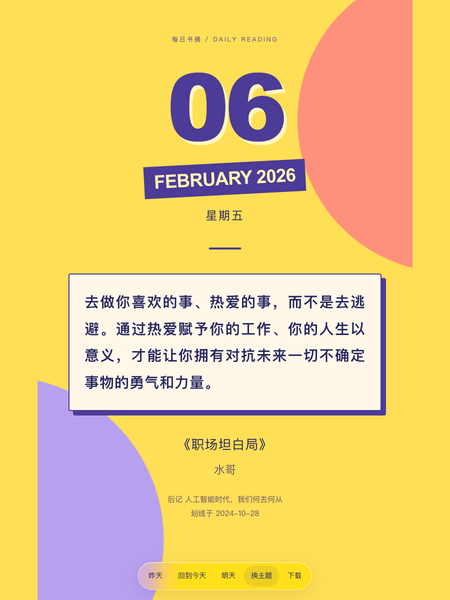
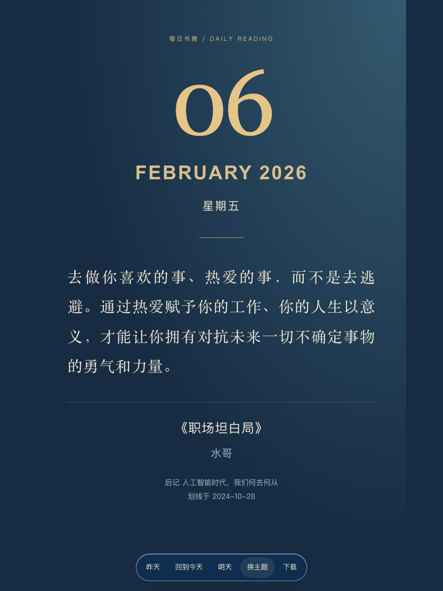

# 微信读书万年历 Skill

把你自己划过的句子，排成一年的阅读日历。

- 从个人微信读书划线导入，默认最多 1000 条，优先覆盖不同书籍。
- 默认排除最近 14 天的划线；全年 365/366 天排期，尽量跨书间隔。
- 五种主题：黑白简约、鼠尾草绿、暖杏柔粉、缤纷撞色、深蓝夜读。
- 底部磨砂按钮：昨天、回到今天、明天、换主题、下载。
- 下载当前卡片为高清 PNG，不包含按钮栏。
- 增量更新只替换部分未来日期，保留今天和过去的安排。

仓库包含 Skill 代码、虚构演示生成器，以及用户明确授权公开展示的 100 条精选书摘（81 本书）。其余 900 条书摘、账号、邮箱、密钥与原私有站点身份未提交。

## 在线体验与示例图片

**[打开 GitHub Pages 体验](https://kemengs-oss.github.io/weread-calendar-demo/)** · [公开体验仓库](https://github.com/kemengs-oss/weread-calendar-demo)

公开版只包含获授权的 100 条精选书摘，全年轮换重读；技能导入默认仍支持 1000 条。

| 鼠尾草绿 | 黑白简约 | 暖杏柔粉 | 缤纷撞色 | 深蓝夜读 |
| --- | --- | --- | --- | --- |
|  |  |  |  |  |

示例图均为宽 900 × 高 1200（高:宽＝4:3），展示同一天的五种主题。点击图片可查看原图。

## 作为 Skill 使用

将 `skills/weread-calendar` 放入你的 Agent 技能目录。例如 Codex 的 `~/.codex/skills/`，之后调用：

> 使用 $weread-calendar，用我的微信读书书摘生成专属万年历。

技能指令见 [SKILL.md](skills/weread-calendar/SKILL.md)。部署及定时运行依赖宿主环境的相应工具，本包不会自动安装、发布网站或创建推送。

## 不配置密钥，先看演示

要求 Node.js 18+。在仓库根目录运行：

```sh
node skills/weread-calendar/scripts/calendar.mjs build --demo --output ./site
python3 -m http.server 8080 --directory site
```

打开 http://localhost:8080 。演示文字和作者均为虚构，不是真实书摘。

## 用自己的书摘

已有 JSON 导出文件可直接生成，不必配置 API Key：

```sh
node skills/weread-calendar/scripts/calendar.mjs build --input ./private/highlights.json --output ./site
```

如果需要官方接口导入，要求 Python 3.9+，先在安全的环境变量/密钥管理中配置 `WEREAD_API_KEY`，不要将值发到聊天或提交到 Git：

```sh
python3 skills/weread-calendar/scripts/import_weread.py --output ./private/highlights.json --limit 1000
node skills/weread-calendar/scripts/calendar.mjs build --input ./private/highlights.json --output ./site
```

API Key 从 [微信读书官方页面](https://weread.qq.com/r/weread-skills) 获取。当前不宣称支持官方 OAuth 或一次性自动失效凭据；默认导入程序不会保存 Key。云端定时同步需要单独配置授权连接。

数据格式及策略见 [数据规则](skills/weread-calendar/references/data-and-calendar.md)。例如 `--year 2027 --timezone Asia/Shanghai --min-age-days 30`。历史日期的卡片是回顾安排，不代表当时已划线或已推送。可用原文不足全年时会重复，生成结果会报告实际不同原文数。

## 更新已有日历

```sh
node skills/weread-calendar/scripts/calendar.mjs update --input ./private/new-highlights.json --output ./site
```

默认每次最多更新 7 个未来日期，且不超过剩余天数的 20%。重复导入会去重；待排的新书摘留在队列。用户明确需要全量重排时才使用 `rebuild`。

网站包含个人原文，默认使用私有托管。`site/` 和 `private/` 已被 Git 忽略；除已明确授权的 100 条公开体验数据外，不要提交个人书摘。HTML 页面需通过 HTTP(S) 打开，支持域名根路径及 GitHub Pages 项目子路径。

## 验证

```sh
node --test tests/calendar.test.mjs
python3 tests/import_test.py
```

本包没有绑定任何既有定时任务或站点。手机浏览器的下载/分享界面由设备决定，不保证直接保存进相册。

## 许可

自有代码 MIT；PNG 导出使用 html-to-image 1.11.13（MIT），许可证随包保留。个人书摘和原书内容的权利不属于本仓库许可。
